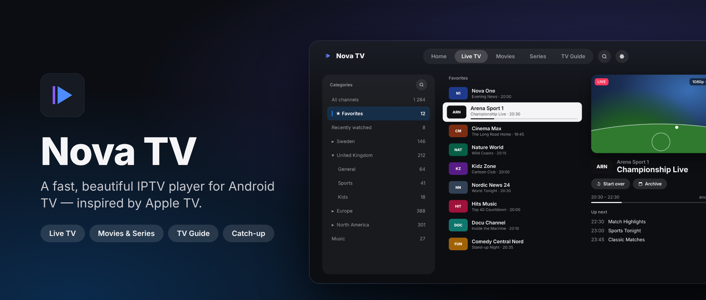
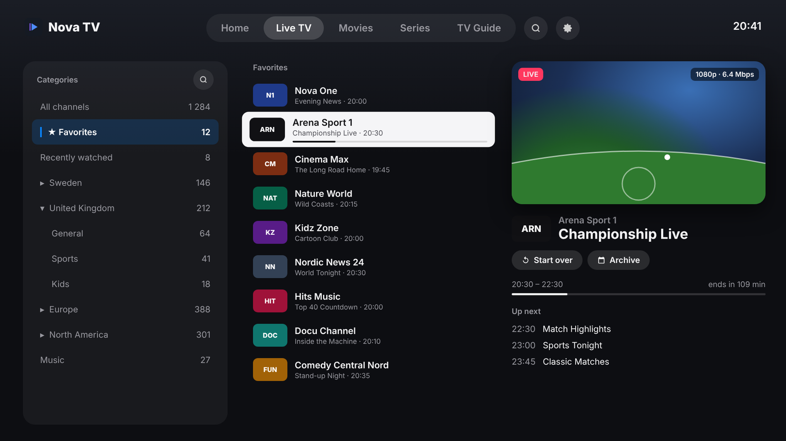
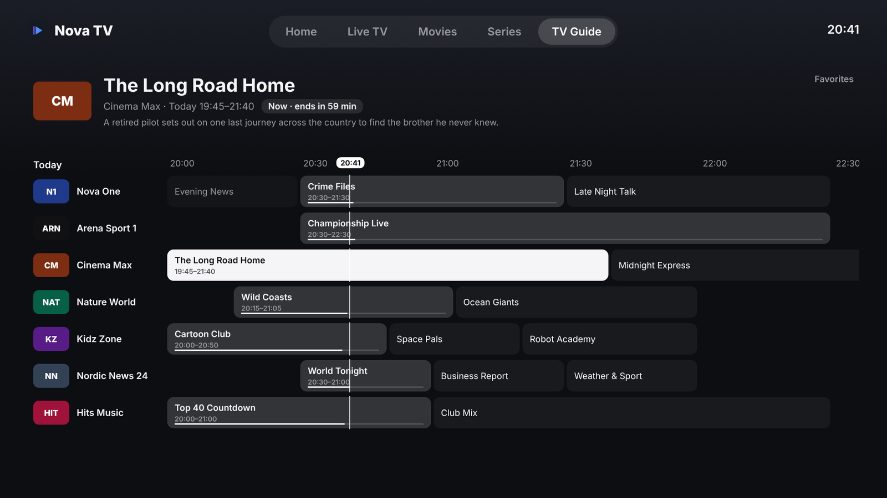
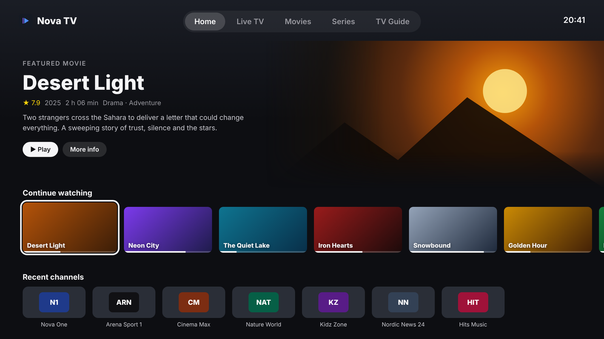

  

<h1 align="center">Nova TV</h1>

  <b>A fast, beautiful IPTV player for Android TV, inspired by Apple TV.</b> 
  Live TV · Movies &amp; Series · TV Guide · Catch-up

  
  
  
  
  

---

  
  &nbsp;
  

## Download

Get the latest `NovaTV-x.y.apk` from **[Releases](../../releases/latest)** and install it on your Android TV / Google TV:

1. Send the APK to the TV with **Send Files to TV**, or open it with the **Downloader** app.
2. Allow *Install unknown apps* for that app when asked.
3. Open Nova TV and sign in with your **Xtream Codes** details or an **M3U link**. You can also scan the QR code and fill them in on your phone.

New versions show up under Releases. Install the new APK on top of the old one and your settings are kept.

## Support Nova TV ♥

Nova TV is **free and has no ads**. If you enjoy it, you can support development here: **[DONATE_LINK](DONATE_LINK)**.
You'll also find a QR code under *Settings → Support Nova TV* in the app.

## Overview

Nova TV is a native Android TV app for watching IPTV. You can sign in with **Xtream Codes** or an **M3U playlist**. The goal is an app that feels like a premium streaming service: calm, glassy, focus-driven navigation that responds instantly to the remote.

Every screen is built for the D-pad:

- Focus is always visible.
- **Back** always takes you to where you were.
- Lists never jump or shake while you scroll.

## Screenshots

| Live TV | TV Guide |
|:---:|:---:|
|  |  |

   
  Home – featured title, continue watching and your recent channels.

The screenshots are design renders of the app's UI. The channel and movie names in them are made up.

---

## Key features

### Live TV

- **Categories in a side panel**, with ★ Favorites, Recently watched and All channels.
- **Smart folders.** Groups that share a country code are grouped into folders automatically, e.g. `EU| UK General` goes into **UK › General**. Region prefixes like `EU`, `AM` and `AS` are split into countries.
- **Live preview** of the focused channel in a rounded, softly shadowed window. It shows the resolution and bitrate, e.g. `1080p · 6.4 Mbps`.
- **Now and next**: what's on now, a progress bar, "ends in X min" and the next programmes.
- **Start over** and **Archive** (catch-up) buttons right under the channel name.
- **Your own favourite order.** Hold OK on a favourite, then choose **Move** to reorder it.
- **Quick navigation**:
  - **Right** on a channel plays it.
  - **Left** opens the categories.
  - **Up** from search jumps to the top menu.

### Full-screen player

- **Up/Down** switches channels. You can also type a channel number, or press **Previous** to jump back to the last channel.
- A glass **info bar** with a timeline. **Back** closes overlays first, then exits.
- **Audio tracks, subtitles and aspect ratio** (fit / fill / stretch).
- **Time-shift**: pause live TV, and rewind on channels that have an archive.
- **Smart buffering**: frozen streams reconnect automatically, and the app falls back between TS and HLS.
- **Automatic retry** on provider auth errors (401/403/…).
- **Always highest quality** and **show bitrate** toggles.
- **Automatic frame rate** and technical info, e.g. `4K · HEVC · HDR10 · 23.976 fps`.

### Movies & Series

- **Apple TV-style browsing**: a large hero at the top with the title, rating, year, length and genres, and rows of posters below.
- **Netflix-style preview.** Rest on a title and a muted preview of it fades in.
- **Smooth rows**: rows glide into place instead of jumping.
- **Continue watching**, **My favourites**, **Recently added**, and **See all** for every group.
- **Detail pages** with the plot, cast and seasons. The series page fits on one screen.
- **Up next**: the next episode starts with a countdown card (Play now / Cancel).

### TV Guide

- **A clean grid guide.** Channels are rows and time runs to the right, with a thin white "now" line.
- **The same category and folder panel as Live TV.** The guide starts on **Favorites**.
- **A large info header** for the focused programme: "Now · ends in 59 min", "Starts in…" or "In the archive".
- **Catch-up**: press OK on a past programme to watch it, or hold OK to start the current one from the beginning.

### Catch-up / Archive

- Works with Xtream `tv_archive` and with M3U `catchup` / `catchup-source` / `catchup-days`. Supported catchup modes are `default`, `append`, `shift`, `xc` and `flussonic`.
- Browse the archive day by day, per channel.

### Channel logos

- Three logo modes: **Provider's logos**, **Clean colour logos** and **Clean monochrome logos**.
- Clean logos are matched automatically from [tv-logo/tv-logos](https://github.com/tv-logo/tv-logos), using the channel name and country code.
- **Channel families share one logo**: *TV4 Sport Live 2* uses the *TV4* logo.
- **Smart contrast**:
  - Dark logos are lightened on dark rows.
  - Logos turn dark on a focused (white) row.
  - Logos that are just a blank shape are shown as clean initials instead.

### Organising

- **Clean channel names**: `|SE| TV4 FHD` becomes `TV4`.
- **Rename** groups and folders.
- **Hide groups**: one at a time, or filter and hide many at once (e.g. `AR, TR`).
- **Favourites** for channels, movies and series.
- **Search** across everything, with a built-in on-screen keyboard.

### Performance

- **Performance mode** for slower TVs: no shadows, glows or previews, and lighter programme info. Turning it off restores everything exactly as it was.
- Previews are capped at 720p, and logo analysis is cached.
- `profileinstaller` for faster startup on newer Android versions.
- Fixed-row layouts and a calm scrolling behaviour, so nothing shakes or jumps.

### Everything else

- **Phone sign-in.** Scan a QR code on the TV and enter your details on your phone (same Wi-Fi).
- **Swedish and English.** The app follows the TV's language, and you can change it in Settings.
- **Offline-first catalogue.** Lists are stored on the TV and refreshed in the background (daily, every 3 days, weekly or manually).
- **EPG**: uses the server's own guide for Xtream accounts, and XMLTV (`url-tvg` or a custom URL) for M3U.
- **History controls**: clear Recently watched channels or Continue watching from Settings.
- **Show/hide the TV Guide tab** from Settings.

---

## Installing on a TV (details)

- **Send Files to TV**: send the APK from your phone and open it on the TV.
- **Downloader app**: paste a direct link to the APK.
- **Emulator**: drag the `.apk` onto an Android TV / Google TV emulator in Android Studio.

> You may need to allow *Install unknown apps* for the app you install from.

---

Nova TV is a player only. It does not provide any channels or content. Use it with a service you have the rights to.

